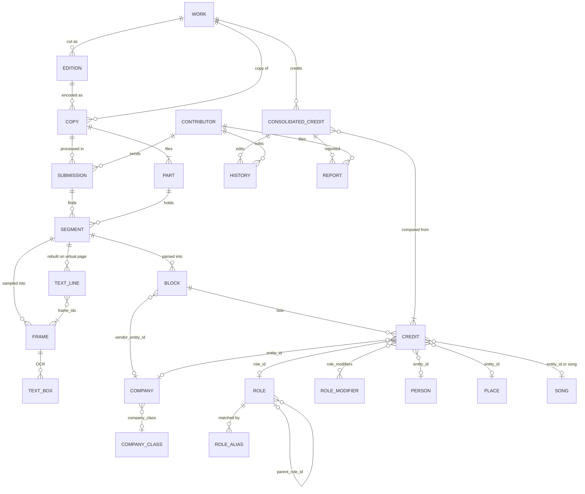
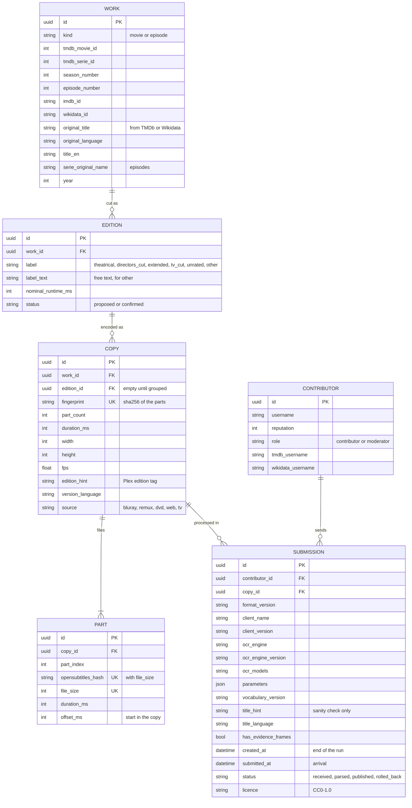
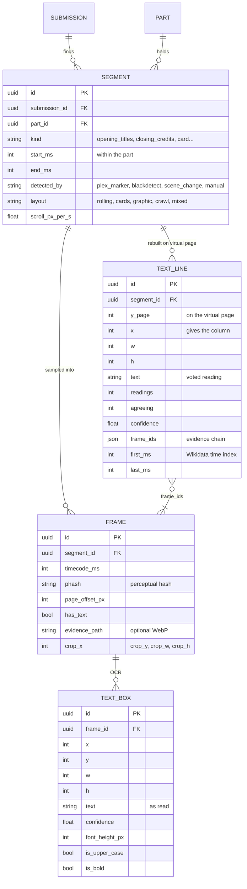
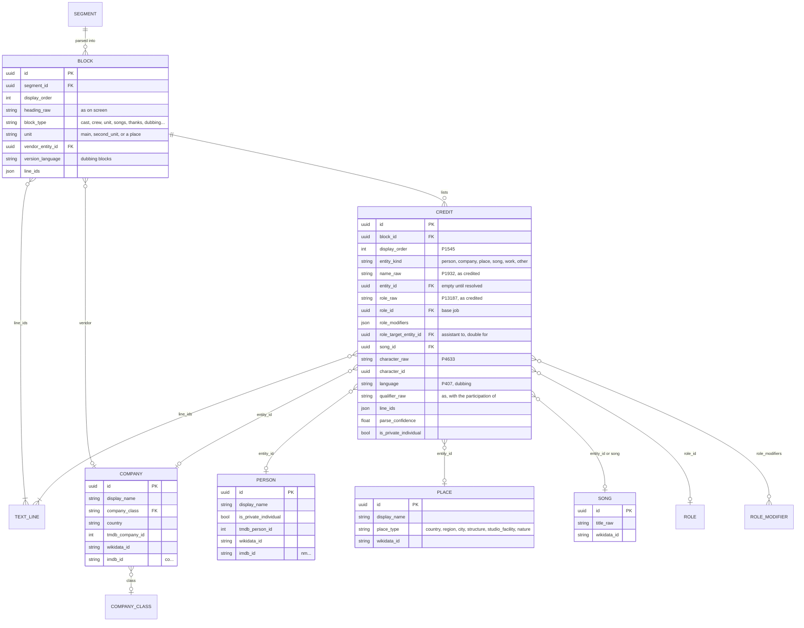
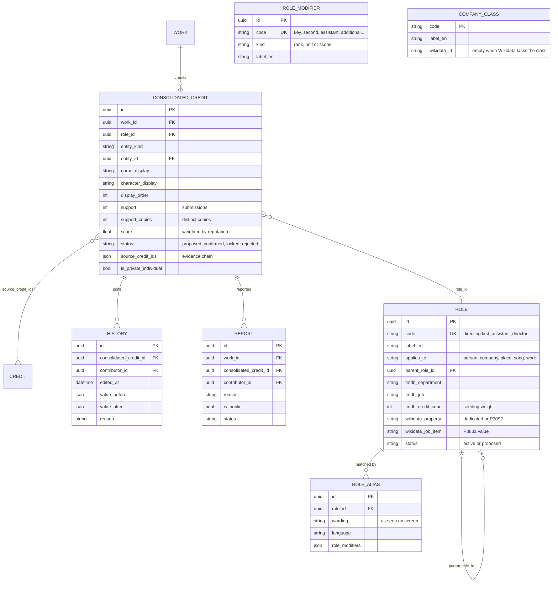

# open-credits data model

Draft 3, 2026-10-16 (draft 1 of 2026-10-15; draft 2 took the six decisions at the end; draft 3 adds editions and multi-part files to layer 0, the review views, and composed roles to layer 5). Status: proposal, to be validated before the pilot writes its SQLite schema (backlog ticket OPEN-CREDITS-002).

The model follows the process, one layer per stage:

| Layer | Stage | What it holds | Who produces it |
|---|---|---|---|
| 0 | the video file | the **work** (a film or an episode), its **editions** (cuts), the **copies** of an edition and the **parts** (files) of a copy | the client, from the contributor's Plex library |
| 1 | the screenshots | **segments** (where the credits are) and **frames** (the images read) | the client, with ffmpeg |
| 2 | the OCR output | **text boxes** per frame, then **text lines** rebuilt across frames on a virtual page | the client, with a CPU OCR engine |
| 3 | the structured credits | **blocks** (the headed sections) and **credits** (one assertion each: who or what, in which role), linked to **entities** (persons, companies, places, songs) | the client parses, the community and the moderators confirm |
| 4 | the consolidated credits | one line per credit of a work, computed from all submissions, editable and lockable | the master database |

The vocabulary of roles (jobs, company roles, place roles) sits beside the layers and is the bridge to TMDb and Wikidata.

Examples below are illustrative. The pilot will replace them with lines read from real films.

---

## Identifiers

- Every row of the master database has a **UUID** (version 7, time-ordered) as its primary key: copies and dumps can be compared and forked without key collisions (charter, decision 24).
- External identifiers are **attributes, never keys**: TMDb ids (`int`), IMDb ids (`tt…`, `nm…`, `co…`), Wikidata Q-ids. A credit stays valid when an external id changes or disappears.
- Physical table names: the names below are logical; in the master each table is `T_WC_OC_<NAME>` (decision 1 at the end).
- Table definitions: [`sql/OC-tables.sql`](sql/OC-tables.sql) for the master (MariaDB, with the mapping from logical to physical column names in its header: `id` becomes `ID_OC_<TABLE>`, `tmdb_person_id` becomes `ID_PERSON` as in `T_WC_TMDB_PERSON`, and so on) and [`sql/client-sqlite.sql`](sql/client-sqlite.sql) for the client's SQLite file, which keeps the logical names.

---

## Layer 0: work and copy

**WORK**: what the credits belong to.

| Field | Notes |
|---|---|
| `id` | UUID |
| `kind` | `movie`, `episode`. A series or a season is never credited as such: credits are read per episode; series-level views are computed |
| `tmdb_movie_id` or `tmdb_serie_id` + `season_number` + `episode_number` | the T2S join keys (`T_WC_TMDB_PLEX_MOVIE` gives them through the Plex catalogue) |
| `imdb_id`, `wikidata_id` | optional |
| `original_title`, `original_language` | the reference title, in the work's original language (TMDb `original_title` and `original_language`, Wikidata P1476 when TMDb has nothing). Filled by the importer from TMDb or Wikidata, **never from the submission**: the title a contributor's Plex shows depends on the language of their library ("Le Parrain" in one, "The Godfather" in another). For an episode, the episode's own title when it has one |
| `title_en` | optional, English title for display, as TMDb shows it by default |
| `serie_original_name` | episodes only: the series' name in its original language, displayed with `season_number` and `episode_number` |
| `year` | release year (first air date for an episode) |

The titles are copied into `T_WC_OC_WORK` as plain values, so the public exports stay readable without the TMDb tables, and no foreign key leaves the OC tables (decision 1). The submission carries only a `title_hint`, in whatever language the client found it, with its `title_language` when known: the importer compares it with the title of the work its external ids point to, as a sanity check, and does not store it as the title.

Below the work, three levels, which Plex already has (a movie, its media, their parts):

- an **edition** is a cut of the work: theatrical, director's cut, extended, TV cut. Two editions can have different credits;
- a **copy** is one concrete encode of an edition (a Blu-ray remux, a DVD rip, a web file), what Plex calls a *media*;
- a **part** is one file of a copy (Plex *part*): most copies have one, some films come as `cd1` / `cd2`.

**EDITION**

| Field | Notes |
|---|---|
| `id`, `work_id` | |
| `label` | `theatrical`, `directors_cut`, `extended`, `tv_cut`, `unrated`, `other` (+ free text) |
| `nominal_runtime_ms` | |
| `status` | `proposed`, `confirmed`: copies are grouped into editions by evidence, see below |

**COPY**: one encode, whoever holds it. Two contributors with the same files share one copy row; this is what makes cross-validation between copies possible.

| Field | Notes |
|---|---|
| `id`, `work_id`, `edition_id` | `edition_id` empty until the copy is grouped |
| `fingerprint` | hash of the ordered list of its parts' identities: the identity of the copy |
| `part_count`, `duration_ms` (sum of the parts), `width`, `height`, `fps` | from ffprobe or Plex |
| `edition_hint` | what the contributor's library says: the Plex `{edition-...}` tag, `FILE_EDITION` (Criterion, Remastered...) |
| `version_language` | the language of the version the credits come from: a French dubbed copy carries French dubbing credits |
| `source` | Blu-ray, remux, DVD, web, TV recording (Plex `FILE_SOURCE`) |

**PART**: one file.

| Field | Notes |
|---|---|
| `id`, `copy_id`, `part_index` | Plex `PART_INDEX` |
| `opensubtitles_hash`, `file_size` | the identity of the file, computed from its content (its size plus its first and last 64 KB), so the **file name plays no part**: the same file renamed by two contributors has the same hash. Plex already computes it (`T_WC_TMDB_PLEX_MEDIA_PART.OPENSUBTITLE_HASH`, `PART_SIZE`), so the client gets it for free. The path is **never** sent: it is private |
| `duration_ms`, `offset_ms` | `offset_ms` = where the part starts in the copy (sum of the previous parts) |

**Same file, same cut: two different questions.**

- *Same file?* The hash answers it, with certainty: same `opensubtitles_hash` and size, same file, whatever its name. A full SHA-256 would be stronger but means reading the whole file (minutes for a 50 GB remux); it can be added later as an optional field.
- *Same cut?* The hash cannot answer it: a 4K remux and a DVD rip of the theatrical cut have different hashes but the same credits. Copies are grouped into an edition from three clues: the `edition_hint`, the duration (allowing for the PAL speed-up, which makes a 25 fps copy about 4 % shorter than the 24 fps one), and the credits themselves (two copies whose closing credits match line for line are the same cut, at least for the credits). The client proposes the grouping; the community confirms it, as with homonyms.

**SUBMISSION**: one run of the client on one copy.

| Field | Notes |
|---|---|
| `id`, `contributor_id`, `copy_id` | a submission covers every part of the copy |
| `client_version`, `ocr_engine`, `ocr_engine_version`, `parameters` (JSON) | reproducibility: the same copy reprocessed by a better engine is a new submission |
| `submitted_at`, `status` | `received`, `parsed`, `published`, `rolled_back` (a sanctioned contributor's submissions are rolled back in one operation) |
| `licence` | always `CC0-1.0`, recorded explicitly |

**CONTRIBUTOR**: an ordinary account (one per person), `reputation`, `role` (`contributor`, `moderator`), optional TMDb and Wikidata usernames.

---

## Layer 1: segments and frames

**SEGMENT**: a stretch of the copy that carries credits.

| Field | Notes |
|---|---|
| `id`, `submission_id`, `part_id` | the part the segment lies in (opening credits in the first part, closing credits in the last) |
| `kind` | `opening_titles`, `opening_credits_over_action`, `closing_credits`, `post_credits_scene`, `recap` (series), `card` (an isolated title card, e.g. a dedication) |
| `start_ms`, `end_ms` | within the part; the part's `offset_ms` gives the time in the copy |
| `detected_by` | `plex_marker`, `blackdetect`, `scene_change`, `manual` |
| `layout` | `rolling` (vertical scroll), `cards` (successive static cards), `graphic` (Saul Bass, text inside images), `crawl`, `mixed` |
| `scroll_px_per_s` | for rolling credits, measured: it is what lets layer 2 put every frame on one virtual page |

**FRAME**: one image read by the OCR.

| Field | Notes |
|---|---|
| `id`, `segment_id`, `timecode_ms` | |
| `phash` | perceptual hash, to drop duplicates and to match frames between copies |
| `page_offset_px` | for rolling credits: where this frame sits on the virtual page (`scroll_px_per_s × (timecode − segment start)`) |
| `has_text` | from the text detector; frames without text are not kept |
| `evidence_path` | optional (charter, decision 3): a cropped WebP of the frame, stored only if the contributor sends it |

---

## Layer 2: OCR output

### 2a. Text boxes (raw, per frame)

The engine's output is normalised to one row per **line box** (not per word: credits are read line by line, and every engine can merge words into lines).

| Field | Notes |
|---|---|
| `frame_id` | |
| `x`, `y`, `w`, `h` | in pixels of the frame; `y_page = y + page_offset_px` |
| `text` | as read |
| `confidence` | 0 to 1, engine-specific |
| `font_height_px`, `is_upper_case`, `is_bold` (if the engine gives it) | the parser needs typography: headings are larger or in capitals |

The engine's native output (Tesseract TSV, PaddleOCR JSON) can be kept beside the submission as an optional archive file, for reprocessing without rereading the video. It is not part of the shared model.

### 2b. Text lines (rebuilt across frames)

On rolling credits the same line appears in many frames, moving up. Projected onto the **virtual page** (the whole roll as one tall image), its readings fall on the same `y_page` and can be merged. On cards, each card is its own short page.

| Field | Notes |
|---|---|
| `id`, `segment_id` | |
| `y_page`, `x`, `w`, `h` | position on the virtual page; `x` gives the **column** (credits are often two columns, job on the left and name on the right, or a centred heading with names below) |
| `text` | the reading chosen by vote among the frames, accents included |
| `readings` | how many frames saw it, how many agree |
| `confidence` | combined |
| `frame_ids` | the frames that saw it: the evidence chain |
| `first_ms`, `last_ms` | when it is on screen: becomes the **time index** of the Wikidata reference |

This table is the pivot of the whole project: everything above it is image processing, everything below it is interpretation. Layer 3 can be recomputed from it with a better parser, without the video.

---

## Layer 3: structured credits

### 3a. Blocks

Credits are organised in **blocks**: a heading followed by entries ("Second Unit", "Visual Effects by Industrial Light & Magic", "Songs", "Special Thanks", "Version française"). A block gives its context to every entry under it.

| Field | Notes |
|---|---|
| `id`, `segment_id`, `display_order` | |
| `heading_raw` | as on screen; empty for the first cast list |
| `block_type` | from the vocabulary: `cast`, `crew`, `unit`, `vendor_staff`, `songs`, `thanks`, `dedication`, `dubbing`, `locations`, `companies`, `legal`, `logos` |
| `unit` | `main`, `second_unit`, `additional_photography`, `aerial`, or a place ("Morocco Unit") |
| `vendor_entity_id` | when the block lists a company's staff ("Visual Effects by Framestore": everyone below works for Framestore) |
| `version_language` | for dubbing blocks |
| `line_ids` | the text lines it covers |

### 3b. Credits

A **credit** is one assertion: an entity, a role, on this work. It always keeps the on-screen wording beside its interpretation, because the wording is the evidence and the interpretation can be wrong.

| Field | Notes | Wikidata equivalent |
|---|---|---|
| `id`, `block_id`, `display_order` | | P1545 series ordinal |
| `entity_kind` | `person`, `company`, `place`, `song`, `work`, `other` | |
| `name_raw` | the name exactly as credited | **P1932** object named as |
| `entity_id` | link to an entity (3c), empty until resolved | the statement's value |
| `role_raw` | the job exactly as credited ("Key 2nd Assistant Director") | **P13187** role named in credits as |
| `role_id` | link to the vocabulary (layer 5): the base job | dedicated property, or P3092 + **P3831** |
| `role_modifiers`, `role_target_entity_id` | rank, unit and scope of a composed role ("Key", "Second Unit", "Assistant to …"), see layer 5 | P13187 keeps the full wording |
| `character_raw`, `character_id` | for cast and dubbing | P4633 / P453 |
| `language` | for dubbing credits | P407 |
| `qualifier_raw` | "(as …)", "with the participation of", "and" | |
| `line_ids` | the text lines it was parsed from | |
| `parse_confidence` | | |
| `is_private_individual` | backers, thanked persons: stored, kept out of the public view and contributions (charter, decision 10) | |

### 3c. Entities

| Entity | Fields | Links |
|---|---|---|
| **PERSON** | `id`, `display_name`, `is_private_individual` | `tmdb_person_id`, `wikidata_id`, `imdb_id` (`nm…`) |
| **COMPANY** | `id`, `display_name`, `company_class` (layer 5), `country` | `tmdb_company_id`, `wikidata_id`, `imdb_id` (`co…`) |
| **PLACE** | `id`, `display_name`, `place_type` (country, region, city, structure, studio facility, nature) | `wikidata_id` (P131 gives the hierarchy), T2S `T_WC_T2S_LOCATION` |
| **SONG** | `id`, `title_raw` | `wikidata_id`; its own credits (performer, writer, label) are credits whose work is the song, nested under the film's `songs` block |

Unresolved names stay on the credit (`name_raw`, empty `entity_id`) and feed the **disambiguation queue**: candidate entities with scores, decided by the community (charter, decision 17: "John Williams" is several people).

---

## Layer 4: consolidated credits (master database)

**CONSOLIDATED_CREDIT**: one per distinct credit of a work, computed from the submissions' credits (grouped by work, role, entity or normalised name, character).

| Field | Notes |
|---|---|
| `id`, `work_id`, `role_id`, `entity_id`, `name_display`, `character_display`, `display_order` | |
| `support` | number of submissions (and of distinct copies) that carry it |
| `score` | agreement weighted by reputation; a single submission is authoritative (decision 15) |
| `status` | `proposed`, `confirmed`, `locked` (by a moderator), `rejected` |
| `source_credit_ids` | the submission credits it comes from: evidence chain down to the frames |

Every edit of a consolidated credit writes a **HISTORY** row (who, when, before, after, reason), as on TMDb. **REPORT** rows (reason, public or private, status) attach to a work or a credit.

---

## Layer 5: the vocabulary (jobs, company roles, place roles)

Neither source is enough alone:

- **TMDb** has 12 departments and about 950 jobs (`/configuration/jobs`; the jobs actually used are already in the T2S database, see decision 4 at the end), all for people. Companies have no roles (production companies only, no distributors, no vendors), and there are no filming locations. Thanks, In Memory Of and Songs exist only as crew jobs.
- **Wikidata** is more precise and extensible: dedicated properties for the main jobs (P57 director, P344 director of photography, P1040 film editor, P5126 assistant director…), **P3092 film crew member + P3831 job item** for every other job (jobs are items, typed *filmmaking occupation* Q4220920 and chained by P279), company properties (P272, P750, P449, P859 sponsor), places (P915), thanks (P7137 acknowledges).

So open-credits keeps its **own vocabulary**, seeded from TMDb's job list and mapped to both:

**ROLE**

| Field | Notes |
|---|---|
| `id`, `code` | stable code, e.g. `directing.first_assistant_director` |
| `label_en` | |
| `applies_to` | `person`, `company`, `place`, `song`, `work` |
| `parent_role_id` | hierarchy: first assistant director → assistant director → director, as P279 does on Wikidata |
| `tmdb_department`, `tmdb_job` | empty if TMDb has no such job |
| `wikidata_property` | dedicated property, or P3092 |
| `wikidata_job_item` | the P3831 value when the property is P3092 |
| `status` | `active`, `proposed` (a job seen on screen that no source has: the community can add roles, as TMDb asks on its forum) |

**Composed roles.** On-screen roles are often a base job plus modifiers: "Key Second Assistant Director", "Second Unit First Assistant Director", "Additional Visual Effects Supervisor", "Assistant to Mr. Nolan", "Stunt Double for Tom Cruise". TMDb flattens these into separate jobs (its 934 jobs include "First Assistant Director Trainee" and "Second Unit Director of Photography"). Stored flat, the vocabulary would grow without end, mostly with roles seen once. open-credits composes them instead:

- **ROLE** holds the base jobs: a few thousand at most, seeded with TMDb's 934 and growing as new jobs are found;
- **ROLE_MODIFIER** holds the modifiers, about a hundred: rank (`key`, `chief`, `head`, `first`, `second`, `assistant`, `additional`, `supervising`, `senior`, `trainee`, `co`), unit (taken from the block: second unit, Morocco unit), scope (`to` or `for` a person);
- the CREDIT carries `role_id`, `role_modifiers` (a list) and `role_target_entity_id` (the person an assistant works for, or a stunt performer doubles).

The wording on screen is always kept in `role_raw` (P13187 on Wikidata), so composing loses nothing. A wording no rule can parse keeps the nearest parent role and the status `needs_role`, for the community to settle.

**ROLE_ALIAS**: the wordings the parser matches on screen, in every language: "Director of Photography", "Cinematographer", "Directeur de la photographie", "Chef opérateur", "Image". This table is what turns `role_raw` into `role_id` and modifiers. It is the large one: every language, every spelling of every job, so tens of thousands of rows in time, which is fine for a lookup table.

Examples of the three kinds of roles:

| Kind | Role | TMDb | Wikidata |
|---|---|---|---|
| person | Director | Directing / Director | P57 |
| person | First Assistant Director | Directing / First Assistant Director | P3092 + P3831 Q141617183 (first assistant director) |
| person | Second Unit Director | Directing / Second Unit Director | P3092 + P3831 Q27890911 |
| person | Gaffer | Lighting / Gaffer | P3092 + P3831 Q1424726 |
| person | Voice actor (dubbing) | **none**: TMDb's Bible excludes dubbed versions | P725 + P407 language + P453 character |
| person | Thanks | Crew / Thanks | P7137 acknowledges |
| company | Production company | production_companies | P272 |
| company | Distributor | none | P750 |
| company | Visual effects vendor | none (only its staff, as crew) | none found: kept in open-credits only |
| company | Dubbing studio | none | none found as a role; the class exists (Q1298801 dubbing studio) |
| company | Sponsor | none | P859 |
| place | Filming location | none | P915 |
| place | Studio facility ("filmed at …") | none | P915 (the facility is a place) |

**COMPANY_CLASS**, for company entities, mapped to Wikidata classes: film production company Q1762059, television production company Q10689397, film distributor Q368290, film studio Q375336, animation studio Q1107679, dubbing studio Q1298801, film laboratory Q388570, television network Q1254874; plus classes Wikidata lacks (visual effects company, equipment rental, post-production house), kept as open-credits classes until Wikidata has an item.

---

## Review views: every layer can be checked on screen

Every result of the process has a view where a person can check it against the image, then validate or correct it (Philippe, 2026-10-16: "every task result needs a GUI so check and validation is possible"). In the pilot, the client writes these views as **static HTML pages** generated from the local SQLite file and opened in a browser, with no server; the master site later serves the same views.

| Layer | View | What it lets one check |
|---|---|---|
| 0 | the copy and its parts, the proposed edition | the grouping of copies into editions |
| 1 | the timeline of the copy with the detected segments, and a strip of the kept frames | that the credits were found, where they start and end |
| 2 | the **virtual page**: the frames of a rolling segment stitched into one tall image, with the text lines drawn over it and their voted text beside | the OCR, line by line, against the image |
| 3 | the credits as a table grouped by block, laid out as on screen (role on the left, name on the right); each line opens the crop of the frame it was read from | the parsing: block, role, name, character |
| 4 | the consolidated credits of the work compared with TMDb and Wikidata: already there, new, conflicting | what to contribute, and where |

Corrections made in a view are written as edits (with HISTORY), never by changing the raw OCR: the raw layers stay the evidence.

## From the model to contributions

**To Wikidata**, a confirmed credit becomes a statement that follows the practice already used on about 1,960 P3092 statements:

- property: the role's dedicated property, or P3092 with qualifier P3831 = the job item;
- value: the entity's Q-id;
- qualifiers: P1932 (name as credited), P13187 (role as credited), P1545 (order), P453 / P4633 (character), P407 (dubbing language);
- reference: P248 *stated in* = the film's own item, P518 *applies to part* = closing credits (Q1553078) or opening credits (Q635115), and P4895 *time index* = `first_ms`.

**To TMDb**, only the roles with a TMDb department and job, and only from the original version (TMDb's rule), as a list per title "on screen, absent from TMDb" that the contributor enters on the website (the API cannot write credits).

**To the T2S database**, the consolidated credits, the entities and the vocabulary, copied as read-only tables.

---

## Diagrams

Four diagrams: the overview of every table and its links, then the columns layer by layer. Logical names; in the master each table is `T_WC_OC_<NAME>` (decision 1). `PK` primary key, `FK` foreign key, `UK` unique identity of a shared row.

### Overview

### Layer 0: work, edition, copy, part, submission

### Layers 1 and 2: segments, frames, OCR

### Layer 3: blocks, credits, entities

### Layers 4 and 5: consolidated credits and vocabulary

Columns the model text leaves unnamed are filled with the obvious choice and should be read as proposals: CONTRIBUTOR's `username`, HISTORY's `edited_at`, REPORT's links, ROLE_MODIFIER's `kind`, ROLE_ALIAS's `wording` and `language`, CREDIT's `song_id` and `character_id`, SUBMISSION's `vocabulary_version` (from the submission format).

---

## Decisions on the open questions (2026-10-16)

The six questions of draft 1, settled by Philippe:

1. **Physical names.** The master lives in the T2S MariaDB database, in `T_WC_OC_*` tables following the ecosystem's conventions (Philippe, 2026-10-17, revising charter decision 30: layer 4 then joins the TMDb and Wikidata tables directly). The lower-case names above are the logical names, used as they are in the client's SQLite file; the importer maps them to `T_WC_OC_*`. The `T_WC_OC_*` tables hold no foreign keys to other `T_WC_*` tables, and export scripts dump them alone, for the public copies.
2. **Dubbing credits** go to Wikidata (P725 voice actor, P407 language) and stay in open-credits. They never go to TMDb, whose Bible excludes dubbed versions.
3. **Company roles without a Wikidata property** (visual effects vendor, dubbing studio, equipment rental) are kept in open-credits only. No property proposal to Wikidata for now.
4. **The TMDb job list** is already in the T2S MariaDB database: the DDL has no reference table, but every job TMDb uses appears as a `CREW_DEPARTMENT` / `CREW_JOB` pair in the credit tables (`T_WC_TMDB_PERSON_MOVIE`, `_SERIE`, `_SEASON`, `_EPISODE`). Checked on 2026-10-16 (`tmdb-crawler/doc/sql/check-tmdb-crew-jobs-20261016.txt`): no table named after jobs or departments, and **952 department/job pairs, 934 distinct jobs** in the credit rows, across the 12 departments plus `Creator` (series). ROLE is seeded from these pairs, with their number of credits as a weight; no API call needed. The jobs that matter here are all present: Second Unit Director (8,863 credits), First Assistant Director (55,182), Thanks (44,578), Songs (16,297), In Memory Of (1,807). A job that TMDb offers but no one has used yet will be missing, which does no harm for seeding.
5. **Songs** take the richer option: a song is an entity (SONG) with its own credits (performer, writer, composer, label), nested under the film's `songs` block, as SONG above describes.
6. **Logos** are out of scope for now: the pilot reads text only, including the text of the last card. Logo recognition comes later, working from the evidence frames kept for the credits; the `logos` block type stays in the vocabulary for that.
